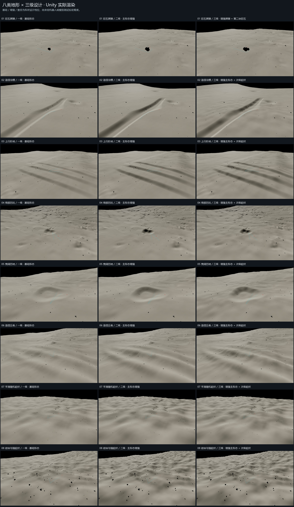

# 八类地形 × 三级：下载与打开（v0.4.0）

## 只看效果：Windows 演示

只需下载 `Lunar_Windows_Demo_v0.4.0.zip`，完整解压后双击
`Lunar_Terrain_Three_Levels/Open_Demo.cmd`。
不要只取出 exe；请保留 WindowsDemo 内的全部文件。
左侧选择八类地形，上方选择基础、增强、复合三级。

## 在 Unity 中打开和编辑

必须下载以下两个普通 ZIP：

1. `Lunar_Unity_Project_v0.4.0.zip`
2. `Lunar_Unity_Resources_v0.4.0.zip`

把两包内容解压到同一个目录，合并同名的 `Lunar_Terrain_Three_Levels` 文件夹。
例如解压到 D:/Terrain 后，应同时存在：

```
D:/Terrain/Lunar_Terrain_Three_Levels/UnityProject/Assets/TerrainLevels
D:/Terrain/Lunar_Terrain_Three_Levels/UnityProject/Assets/LunarPilot
D:/Terrain/Lunar_Terrain_Three_Levels/UnityProject/Packages
D:/Terrain/Lunar_Terrain_Three_Levels/UnityProject/ProjectSettings
```

使用 Unity 2022.3.62f3c1。打开 Unity Hub，添加上述 UnityProject 文件夹。
等待首次导入，打开 Assets/LevelScenes/occlusion_levels_trench_a0.unity，点击播放。
新场景共 24 个；旧场景与源资产同时保留。
两包解压后也可双击根目录的“对比浏览.html”查看图片对比。
两个 Unity 包都必需；只下载工程包会缺少共享源资产。
GitHub 自动提供的 Source code ZIP 不包含完整模型和贴图，请使用上述附件。

## 三级含义与验证范围

八类为 barrier、trench、stairs_up、pit、basin、waves、perlin、perlin_rough。
基础级保留基础人工地形；增强级将主人工形态幅度提高到 1.5 倍；
复合级在增强级上叠加温和次级起伏，石障类改为增加第二块主要遮挡岩石。
真实 DEM 背景不作整体缩放，同一类三级共用水平路线、目标位置和比较相机。

24 场景的 Unity Play Mode 与 Windows 实机运行检查已通过，包含实际 GPU
目标可见性、场景切换和画面检查。界面切换通过运行时入口调用，未测试鼠标逐按钮点击。
目前是相机路线演示；未执行机器人行走、MuJoCo、VLM、RSR@K 或经验难度标定。
基础/增强/复合是设计分级，不能直接宣称已经验证的简单/中等/困难。

完整说明见包内 README_中文.md；证据在 Verification 和 UnityProject/Outputs。
第三方来源见 THIRD_PARTY_NOTICES.md；更早的仓库版本继续保留。


## 校验与设计依据

- [下载工具包](https://github.com/moonspace123/moon-terrain/releases/download/v0.4.0/Lunar_Terrain_Download_Tools_v0.4.0.zip)
- [完整分段清单](https://github.com/moonspace123/moon-terrain/releases/download/v0.4.0/Release_Manifest_v0.4.0.json)
- [SHA-256 校验清单](https://github.com/moonspace123/moon-terrain/releases/download/v0.4.0/SHA256SUMS_v0.4.0.txt)
- [完整性验证记录](https://github.com/moonspace123/moon-terrain/releases/download/v0.4.0/Package_Verification_v0.4.0.json)

三级设计参考 LunarBench V4，固定参考提交为 `a63a83e8a976663565408467955a0fb3f924c77d`：
[V4 设计代码](https://github.com/moonspace123/LunarBench/blob/a63a83e8a976663565408467955a0fb3f924c77d/tasks/task3_reobservability/terrain_design_v4.py)。
本版保留 DEM 大尺度起伏并调整人工地形，属于 Unity 尺度适配，不是原 MuJoCo 场景的逐点数值复现。
源 DEM 分辨率为 2、4 或 8 米；0.25 米网格属于插值细分，不代表新增的真实测量精度。
岩石和地表材质属于类比素材，来源与许可证记录见仓库 THIRD_PARTY_NOTICES.md 和 docs/sources。

交付包 `delivery_verification.json` 汇总 24 场景的检查状态。
`Verification/Player` 保存 Windows 报告，`UnityProject/Outputs/LevelVerification` 保存 Unity 渲染证据。
保留 667 个原有资产文件，便携生成器复现匹配 49 个文件。
这些检查验证工程、渲染和相机遮挡演示，不能代替机器人接触动力学或正式 TASK3 重观测评测。


